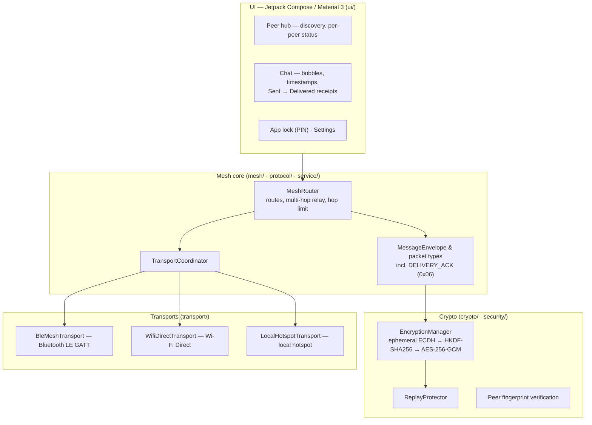

# 📡 Wokie — Offline Encrypted Mesh Messaging

**Chat directly between Android phones with no internet, no server and no account. Messages are end-to-end encrypted and relayed device-to-device over nearby radios — with delivery receipts that prove a message actually arrived.**

   

## Overview

Wokie is an offline-first Android messenger built for the situations where infrastructure is down, absent or untrusted. Two or more phones running Wokie discover each other over nearby radios and exchange messages directly — and can **relay** them across intermediate devices toward a peer that is out of direct range.

- **End-to-end encryption** — every session runs an **ephemeral ECDH key agreement**, derives a 256-bit session key with **HKDF-SHA256**, and encrypts payloads with **AES-256-GCM** (Google Tink's JCE provider). Intermediate relay nodes forward ciphertext they cannot read.
- **Multiple transports, one mesh** — a transport coordinator works across **Bluetooth LE (GATT)**, **Wi-Fi Direct** and a **local hotspot**, so the mesh uses whatever radio path is available.
- **Delivery receipts (v1.2.0)** — in a mesh, "sent" only means a message left your phone. A dedicated `DELIVERY_ACK` protocol packet flips the sender's bubble from **Sent → Delivered** once the peer's device has received and decrypted the message.
- **Replay protection & peer verification** — a replay protector rejects re-sent ciphertext, and peers expose a **verifiable fingerprint** so you can confirm you are talking to the right device.
- **No account, no server** — there is no sign-up and no cloud relay. An app lock (PIN) gates access on the device itself.

## Download

Signed release APKs are published on the [Releases](https://github.com/Manoj-2424150118/Wokie/releases) page — latest: **[v1.2.1](https://github.com/Manoj-2424150118/Wokie/releases/tag/v1.2.1)**. Releases from v1.1.0 onward are signed with a permanent release key, so updates install in place. Requires Android 8.1 (API 27) or newer — and a second phone with Wokie installed to chat with.

> **Upgrading from v1.0 / v1.0.1:** those builds used throwaway debug keys — uninstall the old app first, then install the current release.

## Architecture



A raw-socket transport also exists in the codebase; it points at an emulator host address and exists for two-device automated testing, not as a user-facing path.

## Threat model

| Asset | Adversary | Mitigation |
|---|---|---|
| Message contents on the radio link | Passive eavesdropper within radio range | End-to-end encryption: ephemeral ECDH + HKDF-SHA256 session keys, AES-256-GCM payloads — captured traffic is ciphertext |
| Message contents at a relay | Malicious or curious intermediate node | Relays forward encrypted envelopes and hold no session keys; the router only decrements the hop limit and passes ciphertext on |
| Session integrity | Active attacker replaying old traffic | Replay protection rejects previously seen ciphertext; packet types and hop limits are enforced by the router |
| Peer identity | Impostor device joining the mesh | Peer fingerprints can be compared out-of-band to verify you are connected to the intended device |
| The app on a lost phone | Finder / thief | App lock (PIN) gates the UI; there is no account or server copy of conversations to attack |
| Availability | No infrastructure at all | By design: no server, account or internet is required — discovery and relay run entirely on local radios |

**Honest limits:** nearby radios inherently expose that devices are present and talking; Wokie protects message *content*, not the fact of communication. Real-device BLE behaviour is verified on physical hardware — the JVM suite covers protocol and crypto logic, not radio firmware quirks.

## Tech stack

| Layer | Technology |
|---|---|
| Language | Kotlin |
| UI | Jetpack Compose · Material 3 |
| Encryption | Ephemeral ECDH · HKDF-SHA256 · AES-256-GCM (Google Tink JCE) |
| Networking | Bluetooth LE (GATT) · Wi-Fi Direct · Local hotspot — behind a `WokieTransport` abstraction with a coordinating router |
| Protocol | Custom packet envelope with typed packets (incl. `DELIVERY_ACK`), multi-hop relay with hop limit |
| Platform | Android — minSdk 27 (Android 8.1), target/compileSdk 34 · AGP 8.2 · Gradle 8.2 |
| Current release | v1.2.0 (versionCode 4) — delivery receipts |

## Setup & build

1. Install **Android Studio** (JDK 17 toolchain) and clone the repository.
2. Open the project and let Gradle sync.
3. Build and test:

```bash
./gradlew assembleDebug        # debug APK
./gradlew testDebugUnitTest    # JVM unit tests (96 tests)
./gradlew assembleRelease      # release APK (requires the release keystore — maintainer builds)
```

Mesh features need **two physical Android devices** to exercise peer discovery and relay; see `TWO_DEVICE_TEST.md` in this repository for the manual two-device test plan. End users should simply install the signed APK from [Releases](https://github.com/Manoj-2424150118/Wokie/releases).

## Testing

- **96 JVM unit tests** (`app/src/test/…`) covering the crypto layer (key agreement, encryption, replay protection, peer fingerprints), the protocol (message envelopes, physical packet framing), the mesh discovery state machine, session recovery and a two-peer integration test.
- **CI:** the Android CI workflow builds the app and runs the unit tests on every push to `main`.

## Security

Report vulnerabilities privately, per **[SECURITY.md](SECURITY.md)** — please do not open public issues for security reports.

## License

MIT — see [LICENSE](LICENSE) for the full text.
